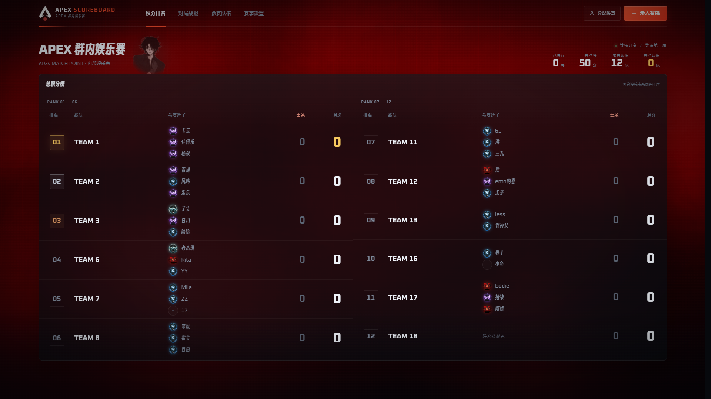
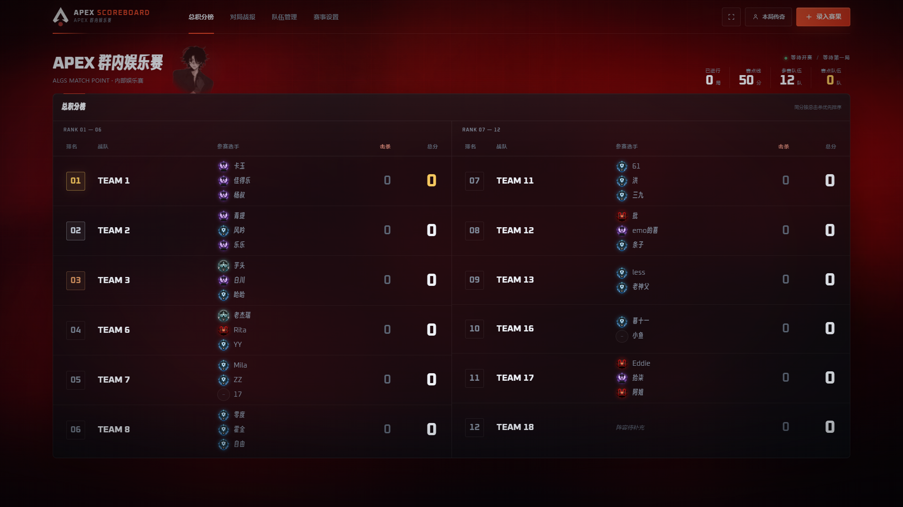
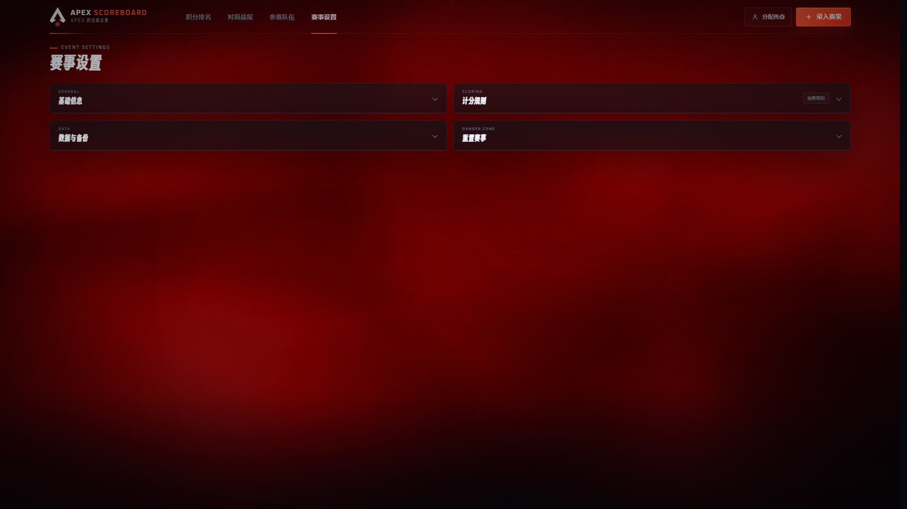
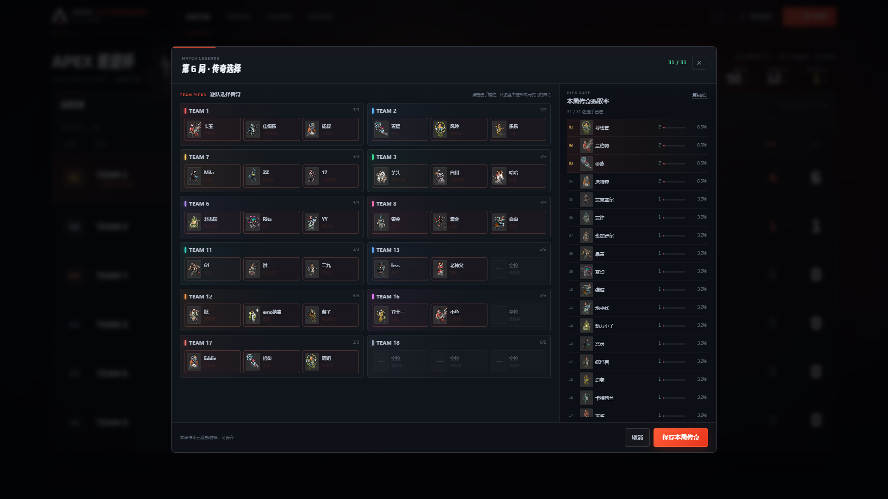
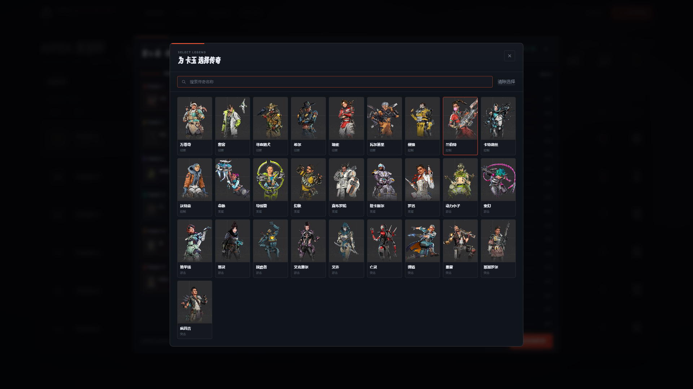
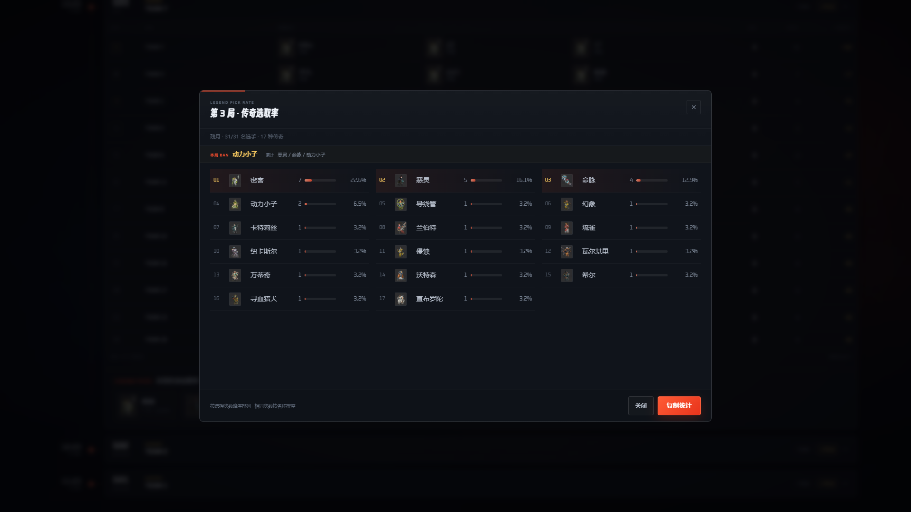
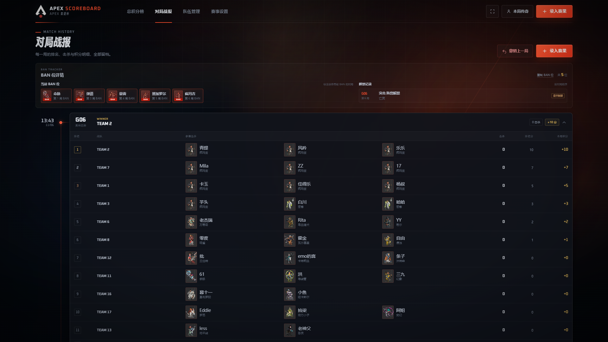

# APEX 青提杯 · 记分板

一个为 Apex Legends 青提杯 / 训练赛准备的本地记分网站，按照 **ALGS Match Point（赛点制）** 计算积分，适合直播时在每局结束后展示。

页面默认已录入截图中的 12 支队伍和选手名单，并根据原名单配置了段位徽章；所有队伍名、选手、段位、赛事名称、赛点线都可以在网页内修改。



## 启动

需要本机安装 Node.js。

直接双击：

- `start.cmd`：后台启动本地服务
- `stop.cmd`：停止本地服务
- `open.cmd`：打开网页；如果服务未运行，会先自动启动

也可以在当前目录手动运行：

```bat
npm start
```

启动后打开：

```text
http://127.0.0.1:4318
```

后台运行日志保存在 `.runtime` 目录。

服务监听 `0.0.0.0`，同一局域网内的其他设备也可以访问启动日志中打印的 `LAN` 地址。不过数据保存在**当前浏览器**的 `localStorage` 中，不同电脑之间不会自动同步，建议只在一台 OB 机上操作，并定期导出备份。

## 访问权限

- 新打开网页时默认为**只读模式**，只能查看「积分排名」和「对局记录」。
- 连续点击三次左上角 `APEX SCOREBOARD`，输入当前管理密码即可解锁编辑功能。
- 管理密码格式为 `Naana` + 当前小时和分钟（24 小时制、两位补零），例如 21:22 对应 `Naana2122`。
- 解锁状态保存在当前标签页的 `sessionStorage` 中，刷新页面仍保持管理状态；关闭标签页后重新打开会回到只读模式。

## 主要功能

- **双列总积分榜**：按排名左右均衡分列（单列最多 10 队，当前 12 队为 6 + 6），只展示排名、队伍、参赛选手与段位图标、击杀、总积分；击杀数字使用红色强调，赛点队伍使用较淡的橙色渐变背景，并在队名下方显示 `MATCH POINT`。
- **单局赛果录入**：先从下方队伍池拖入排名，再填写击杀；放入后可拖动整行调整顺序，也可一键按当前总积分填入。击杀数、排名分、本局总分分列显示，实时预览本局积分。
- **赛前传奇分配**：每局开始前点击「分配传奇」，按队伍、选手选择本局使用的传奇；支持搜索、清除选择，右侧会实时计算本局传奇选取率。保存赛果前必须为所有有选手的槽位补全传奇。
- **单局传奇选取率**：赛果保存后自动生成该局的传奇选取率排名；对局详情先展示前三名摘要，点击前三名后面的「+N」在弹窗中查看完整榜单。弹窗内可一键复制带本局 BAN 和累计 BAN 的群通知文本。历史对局没有传奇数据时不会显示该区块。
- **BAN 位详情**：对局记录顶部展示当前 BAN 位、每个 BAN 是在第几局产生，以及每一次阵营解禁发生在第几局、解禁了哪些传奇；右上角可直接复制当前 BAN 位清单。
- **ALGS 赛点制**：达到赛点线后获得资格，赛点队伍之后吃鸡即夺冠，赛事随即定榜并锁定录分。
- **对局记录**：每局完整排名、每位选手当局使用的传奇头像与名字、击杀、排名分与积分明细；左侧时间线显示每局录入的日期与时刻，由下到上为从早到晚。
- **参赛队伍**：添加 / 编辑队伍，自定义队名、三位选手和每位选手的段位；队伍卡片不再手动设置队色，统一按队内最高段位自动配色。可以为实力过强的队伍勾选「能力限制」，卡片会保留专属斜纹与径向光效，但改用更亮的高段位颜色，不再使用金色。卡片背景中央带有淡淡的 `T1` / `T12` 队伍编号水印。
- **赛事设置**：修改赛事名、副标题、赛点线；切换阵营 BAN 解禁方案；选择复制统计展示前三 / 前五 / 全部；切换段位渐变 / 暗红网格背景动效；在计分规则中打开「赛制介绍」；查看计分规则。
- **背景动效**：「段位渐变」使用旋转棱镜、流光带、粒子层和扫光柱；背景光色按「猎杀红 → 大师紫 → 钻石蓝 → 铂金 → 黄金 → 猎杀红」循环，每种颜色停留 60 秒，颜色之间用 10 秒平滑过渡，一轮约 5 分 50 秒。「暗红网格」完整保留原背景。可在赛事设置中随时切换，默认段位渐变。
- **半透明磨砂卡片**：总积分榜、队伍卡片、对局卡片、BAN 位详情和设置面板统一使用半透明深色底与背景模糊，背景动效可以透出。


- **数据备份**：导出 / 导入 JSON 备份；清空对局或恢复默认名单。
- **数据存储**：Netlify 部署使用同站点的 Functions + Blobs；自建服务器使用 `server.js` + `data/state.json`。两种模式共用同一套前端，观众端只读加载，管理员修改后自动同步；当前浏览器保留一份本地缓存。

- **自动保存**：每次修改自动写入当前浏览器的 `localStorage`。

## Netlify 部署

当前线上使用 Netlify。前端是纯静态站点，不需要构建：

- 前端静态文件在 `edgeone-deploy` 目录；如果只做纯静态预览，可以上传这个目录。
- 正式使用必须通过 Git 连接或 Netlify CLI 部署整个项目根目录，才能同时部署 Functions。
- 仓库根目录已提供 `netlify.toml`，发布目录为 `edgeone-deploy`，Functions 目录为 `netlify/functions`。
- 不需要 Node 服务，`server.js` 不参与部署。
- 部署后在 Netlify 域名重新进入管理模式，填写管理 Token，再上传数据和复制观众链接。

### Netlify 云端存储

数据存储使用：

- `netlify/functions/state.mjs`：读写接口
- Netlify Blobs：实际数据存储
- 环境变量 `ADMIN_TOKEN`：写保护

注意：**Netlify Drop 这类纯静态拖拽部署不会包含 Functions**。要使用 Netlify 云端存储，必须通过 Git 连接或 Netlify CLI 部署整个项目根目录。

设置环境变量：

```text
Site configuration → Environment variables → ADMIN_TOKEN
```

然后重新部署。函数地址应能访问：

```text
https://你的站点.netlify.app/.netlify/functions/state
```

部署后测试：

```text
https://你的站点.netlify.app/api/state
```

返回 `state: null` 就说明 Function 正常，可以去后台测试连接并上传数据。

如果没有权限设置 Netlify 环境变量，可以在 `netlify/functions/state.mjs` 顶部使用哈希后备方案：

```js
const ADMIN_TOKEN_SHA256 = '你的令牌SHA256哈希';
```

生成哈希：

```powershell
$token = '自己设置一个足够长的随机令牌'
$sha = [Security.Cryptography.SHA256]::Create()
$hash = $sha.ComputeHash([Text.Encoding]::UTF8.GetBytes($token))
(-join ($hash | ForEach-Object { $_.ToString('x2') })).ToLower()
```

把得到的哈希填进 `ADMIN_TOKEN_SHA256`，重新部署，然后在网站“管理 Token”里填写原始令牌。这样不需要环境变量；仓库如果是公开的，也只暴露哈希，不暴露原始令牌。

如果部署 v2 Function 后仍然出现 `MissingBlobsEnvironmentError`，可以在 `netlify/functions/state.mjs` 顶部填写手动 Blobs 配置：

```js
const BLOBS_SITE_ID = '你的站点ID';
const BLOBS_ACCESS_TOKEN = '你的Netlify个人访问令牌';
```

站点 ID 可在 Netlify 的 Site configuration → Site information 查看。个人访问令牌在 Netlify 用户设置 → Applications → Personal access tokens 创建。此令牌权限较大，仓库必须保持私有，不要提交到公开仓库。

## 自建服务器部署

同一套前端也支持放在自己的服务器上，数据保存在服务器 JSON 文件中，不需要 MinIO、图床或数据库。

服务器模式：

- 前端静态文件：`index.html`、`styles.css`、`app.js`、`legends.js`、`assets/`
- 接口：`server.js` 的 `/api/state`
- 数据：`data/state.json`
- 图片：直接放在 `assets/`，由 Node 或 Nginx 静态返回

### 启动

```bash
cd /var/www/apex-scoreboard
cp .env.example .env
# 编辑 .env，填入 ADMIN_TOKEN
npm start
```

默认地址：

```text
http://服务器IP:4318
```

`server.js` 支持：

- `GET /api/state`：公开读取
- `PUT /api/state`：需要 `Authorization: Bearer <ADMIN_TOKEN>`
- 兼容 `/.netlify/functions/state`
- 静态资源缓存和 `data/`、`server.js` 等敏感路径保护

### Nginx 反向代理

```nginx
server {
    listen 80;
    server_name your-domain.com;

    location / {
        proxy_pass http://127.0.0.1:4318;
        proxy_set_header Host $host;
        proxy_set_header X-Real-IP $remote_addr;
        proxy_set_header X-Forwarded-For $proxy_add_x_forwarded_for;
        proxy_set_header X-Forwarded-Proto $scheme;
    }
}
```

再按需配置 HTTPS。

### 数据说明

- 服务器数据在 `data/state.json`，可直接备份这个文件。
- Netlify Blobs 和服务器 JSON 是两套独立存储，不会自动互相同步。
- 从 Netlify 迁移到服务器时：在 Netlify 后台导出 JSON，再到服务器站点导入，然后上传一次。

## 传奇录入与 BAN 位统计

每局开始前：

1. 点击顶栏「分配传奇」。
2. 点击每支队伍三位选手的槽位，从传奇图鉴中选择本局使用的传奇；支持按名称搜索。
3. 右侧会实时显示本局传奇选取率排名，也可直接「复制统计」。
4. 点击「保存传奇」。允许先保存部分选择，但保存赛果前必须补全所有有选手的槽位。

赛果保存后：

- 该局详情底部会显示前三名传奇摘要，点击前三名后面的「+N」打开完整榜单弹窗。
- 弹窗内按选择次数降序排列，点击「复制统计」会生成选取率、本局 BAN 和累计 BAN 的文本，方便直接发群。
- 「赛事设置 → 复制统计展示数量」可以选择复制前三个、前五个或全部传奇；弹窗内始终显示完整排名。
- 每局只新增一个 BAN：取本局选取率最高、且尚未被 ban 过的传奇；选取数量相同时，比较使用该传奇的队伍的最高排名。
- 密客永远不进入 BAN 位；如果密客选取率最高，则自动顺延到下一名。
- 之前已经 ban 过的传奇会一直保留在累计 BAN 中，并随每局复制文本一起输出。

### 阵营 BAN 解禁

当某个阵营所有可进入 BAN 位的传奇都被 BAN 后，会立即触发一次自动解禁。密客永远不进入 BAN 位，也不计入阵营“全员”数量。

可以在「赛事设置 → 阵营 BAN 解禁规则」切换，默认方案一：

- **方案一（默认）**：只移出该阵营最早被 BAN 的传奇。
- **方案二**：该阵营所有传奇立即移出 BAN 位。

切换方案后会按新规则重新计算所有对局的累计 BAN。


- 撤销该局时，传奇选择会恢复为待录入草稿，方便修改后重新保存赛果。

传奇名称、职业分类和头像来自 [游民星空 APEX 图鉴](https://www.gamersky.com/tools/apexwiki/list.html?kind=legend&filter=%E5%85%A8%E9%83%A8)，共 28 位，已下载到本地 `assets/legends/`，离线也能正常显示。







## 选手段位

每位选手可以单独选择段位，段位会以徽章显示在总积分榜、队伍名片和冠军弹窗中。对局记录的选手列显示当局传奇头像、选手名和传奇名，不显示段位徽章。积分榜只显示徽章图标，不显示段位文字；队伍管理中保留段位名称，便于编辑。所有非空段位徽章带有低亮度的右下到左上循环高光。

| 段位 | 标识色 | 徽章文件 |
| --- | --- | --- |
| 菜鸟 | `#98A4B3` | `assets/ranks/rookie.png` |
| 青铜 | `#C57B4B` | `assets/ranks/bronze.png` |
| 白银 | `#CAD4DE` | `assets/ranks/silver.png` |
| 黄金 | `#F5C451` | `assets/ranks/gold.png` |
| 铂金 | `#6FFFFA` | `assets/ranks/platinum.png` |
| 钻石 | `#2EB9FF` | `assets/ranks/diamond.png` |
| 大师 | `#A462FF` | `assets/ranks/master.png` |
| 猎杀 | `#DC1717` | `assets/ranks/predator.png` |

段位只用于展示，不影响积分和比赛判定。背景「段位渐变」只使用黄金、铂金、钻石、大师、猎杀五种颜色，菜鸟、青铜、白银不参与背景循环。

## 对局时间线

「对局记录」左侧会按每局录入时间生成一条时间线：

- 纵向顺序为**上方最新、下方最早**，从下往上阅读就是从早到晚。
- 每个记录与时间线的交点都有一个圆点，鼠标悬停或键盘聚焦时点亮。
- 时间线旁显示该局的录入日期与时刻；时间来自浏览器本地时间。



## 字体

为了避免默认的 Windows 中文字体观感，网站内置了两款开源字体：

- **Smiley Sans（得意黑）**：用于中文标题、队名和选手名，更有电竞视觉风格。
- **Oxanium**：用于英文、数字和比分，字形更硬朗、适合游戏数据面板。

字体文件全部放在本地 `assets/fonts/`，离线也能正常显示。授权文件也一并放入该目录。

## 计分规则

| 最终排名 | 1 | 2 | 3 | 4 | 5 | 6 | 7+ |
| --- | --- | --- | --- | --- | --- | --- | --- |
| 排名分 | 10 | 7 | 5 | 3 | 2 | 1 | 0 |

- 第 6 名 1 分，第 7 名及以后 0 分。
- 每击杀额外获得 **1 分**。
- 总积分达到赛点线（默认 **50 分**）后获得赛点资格。
- **赛点资格在每局开始前结算**：已经达到赛点线的队伍，在本局吃鸡即夺冠。
- 如果队伍是在本局中才达到赛点线，即使本局吃鸡，也需要在之后的局中再次吃鸡才能夺冠。
- 产生冠军后积分榜定榜，不能继续录分；如需修正，在「对局记录」中撤销冠军对局即可解除定榜。
- 同分排序：总积分 → 总击杀 → 单局最佳排名 → 吃鸡次数 → 初始队伍顺序。

## 操作提示

- 顶栏或键盘 `N`：打开本局赛果录入。
- 顶栏「分配传奇」：打开分配传奇选择；也可在赛果录入窗口右上角点击传奇状态补录。
- 录入窗口中：先从下方队伍池拖入上方的本局排名，放好后拖动整行调整顺序并填写击杀；橙色插入线会标出将插入到哪两支队伍之间。从队伍池拖动时，列表下方会临时出现固定投放区，可直接放到最后一名；全部队伍放完后队伍池和投放区自动隐藏。队伍名右侧的 `×` 可把队伍放回池子。
- 赛果窗口的「传奇 X/Y」显示本局已选人数；未补全时「保存本局赛果」不可用，点击该状态可打开传奇补录。
- 参赛队伍中，每个选手右侧可以单独选择黄金 / 铂金 / 钻石 / 大师 / 猎杀段位。
- 编辑队伍时可勾选「选手实力过强 · 能力限制」；保存后队伍卡片会出现更亮段位色的边框、斜纹背景和队名旁的「能力限制」标记，仅用于提示，不影响积分计算。
- 有对局记录后，赛点线会锁定，防止历史赛点资格被重算。
- 已有对局记录的队伍不能删除；如需调整请先清空对局。
- 换电脑、换浏览器或清理浏览器数据前，务必先在「赛事设置 → 数据与备份」导出 JSON。
- 「恢复初始名单」会清除对局和赛事设置，并恢复已保存的自定义队伍名单；没有对局时编辑队伍会自动更新这份初始名单。

## 文件说明

```text
apex-scoreboard/
├─ index.html          页面结构
├─ styles.css          视觉样式与响应式布局
├─ app.js              计分逻辑、段位、录分、管理、持久化
├─ server.js           零依赖静态服务器 + 自建数据 API
├─ .env.example        自建服务器环境变量示例
├─ data/               自建服务器数据目录（state.json）
├─ start.cmd           后台启动服务
├─ stop.cmd            停止服务
├─ open.cmd            打开网页（必要时自动启动）
├─ server-control.ps1  启动、停止、打开的控制脚本
├─ legends.js          传奇名称、职业与本地头像索引
├─ favicon.png         由提供的 Apex logo 生成的网站图标
├─ preview.png         主界面预览图
├─ preview-background.png 段位渐变背景预览图
├─ preview-entry.png   单局录入窗口预览图
├─ preview-entry-drag.png 拖拽插入线预览图
├─ preview-entry-filled.png 全部排名完成预览图
├─ preview-matches.png 对局时间线预览图
├─ preview-legends.png 赛前传奇录入与实时选取率预览图
├─ preview-legend-picker.png 传奇图鉴选择器预览图
├─ preview-legend-report.png 单局传奇选取率弹窗预览图
├─ preview-ban-rule.png 阵营 BAN 解禁规则设置预览图
├─ preview-team-dialog.png 队伍编辑窗口预览图
├─ preview-team-limit.png 队伍能力限制标记预览图
├─ preview-champion.png 冠军弹窗预览图
├─ assets/
│  ├─ apex-logo.png    网站主图标
│  ├─ qingti.png       青提杯创办者头像
│  ├─ legends/
│  │  ├─ thumbs/       28 位传奇的小头像
│  │  └─ cards/        28 位传奇的图鉴卡片图
│  ├─ ranks/           黄金、铂金、钻石、大师、猎杀段位徽章
│  └─ fonts/           Smiley Sans、Oxanium 字体及 OFL 授权文件
└─ README.md
```
